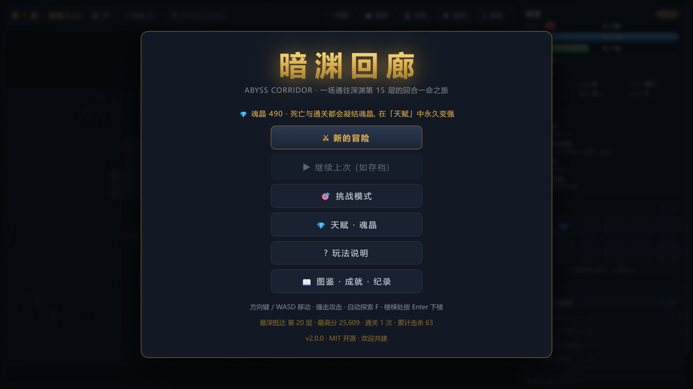
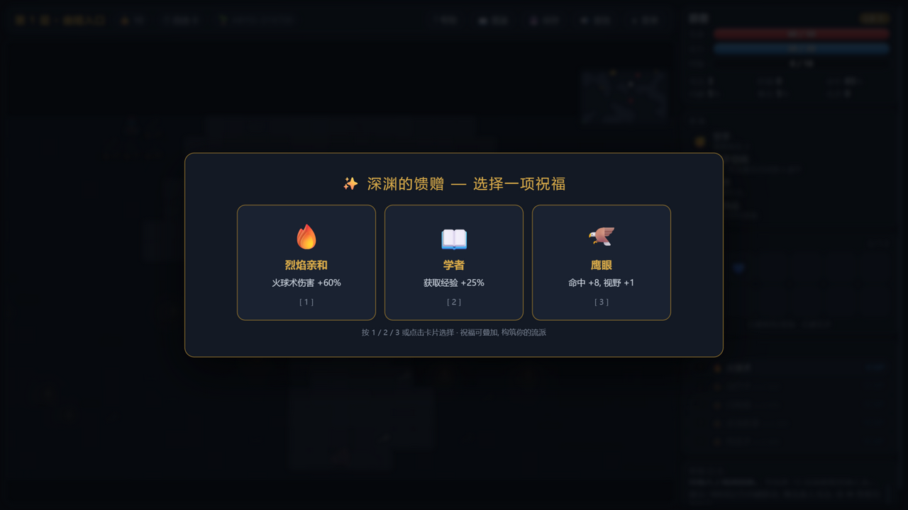
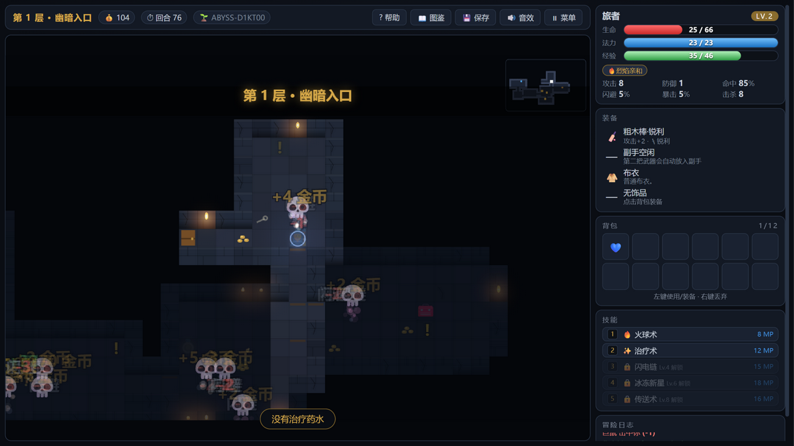

# 暗渊回廊 · Abyss Corridor

一款**纯浏览器单机 Roguelike 地牢探险游戏**。零依赖、零素材、零联网——双击 `index.html` 就能玩。

所有图形由 Canvas 程序化绘制，所有音效由 WebAudio 实时合成，所有数据存在浏览器本地。

<p align="center">
  
  
  
</p>
<p align="center"><sub>左：标题画面 · 中：每层祝福三选一 · 右：第一层战斗（实机截图）</sub></p>

---

## 🎮 快速开始

**方式一（推荐）**：双击 [index.html](index.html)，用 Chrome / Edge 打开即可。

**方式二**：使用打包好的单文件版 [dist/abyss-corridor.html](dist/abyss-corridor.html)，一个文件带走整个游戏。

> 无需安装、无需 Node、无需服务器。首次点击/按键后音效才会解锁（浏览器策略）。

## ✨ 特性

- **15 层深渊**：房间/洞穴/竞技场三类程序化地图，第 5/10/15 层 Boss 把守，屠龙通关后进入**无尽回廊**
- **三系职业**：开局选择 ⚔️ 战士 / 🏹 游侠 / 🔥 法师 — 不同的初始武器与属性倾向，每种都值得重玩
- **武器即 Build**：近战 6 档 + **远程武器**（弓·直线弹道 / 法杖·自动锁定耗蓝 / 回旋刃·去回双击），**双武器槽** X 键秒切
- **随机词条**：掉落装备附带 0~2 条词条（吸血/灼烧/毒刃/冰寒/连击/破甲/巨力/棘甲…），名字即配置
- **局内构筑**：每层开始**祝福三选一**（23 种可叠加：汲血/荆棘/狂怒/破军/处决者… + 高风险诅咒卡），滚出你的流派
- **回合制战斗**：撞击攻击、暴击/闪避/命中、毒/灼烧/冰冻/力量/护盾/再生
- **18 种敌人 + 3 Boss**：蝙蝠双动、幽魂穿墙、**冲锋野猪**直线突进、**暗影僧**治疗同伴（优先击杀）、**岩蟹**重甲；精英怪金光必掉好货且带**随机词缀**（迅捷/灼热/虹吸/荆棘…名字即威胁）；**关门打狗**伏击房清场开宝箱；Boss 半血狂怒二阶段 + **登场演出**
- **剧情与收集**：开场楔子、每层引言、深渊低语、三个交互 NPC；15 枚**记忆碎片**（掘金队日记）散布全层，图鉴「回响」页拼出完整故事
- **成长体系**：等级、6 档防具、9 种饰品、12 格背包、5 个技能
- **经济与设施**：商店（踩上商品按 Enter 购买）、宝箱、泉水、献祭祭坛
- **Roguelite 元循环**：死亡/通关结算**魂晶** → 主菜单**天赋树** 12 项永久成长（生命/攻击/开局装备/视野/探图…）→ 下一局更强
- **挑战因子**：疯狂 / 浓雾 / 坚壁 三种开局挑战 + **每日挑战**（全世界同一天同一张地牢），魂晶 ×1.5
- **探索体验**：递归阴影投射视野 + 战争迷雾、固定地图镜头（可选平滑跟随）、小地图、悬停查看、自动探索（探完自动前往楼梯）、自动寻路点地移动、休息
- **手感与氛围**：粒子/飘字/弹道/屏幕震动、受击闪白与微顿帧、低血量心跳、每层专属色调、程序化砖墙与火光、像素字体 UI、WebAudio 合成音效与环境垫音
- **Meta 系统**：20 项成就、敌人图鉴、回响故事集、最高纪录；自动存档 + 手动保存，死亡删档
- **全中文界面**，键鼠双操作

## ⌨️ 操作

| 按键 | 功能 |
|---|---|
| 方向键 / WASD | 移动（撞击敌人 = 攻击） |
| Enter / G | 下楼 · 交互（泉水/宝箱/祭坛/购买） |
| 空格 / `.` | 原地等待一回合 |
| F | 自动探索（探完自动前往楼梯，遇敌中止） |
| R | 原地休息至满血（遇敌中止） |
| 1 ~ 5 | 释放技能（自动锁定最近敌人） |
| X | 切换主/副手武器 |
| Q | 快速喝治疗药水 |
| Z / H / M / Esc | 图鉴 / 帮助 / 静音 / 暂停菜单 |
| 鼠标左键 | 点地砖自动寻路 · 点敌人走近攻击 |
| 鼠标悬停 | 查看敌人/物品/设施信息 |
| 背包左键 / 右键 | 使用·装备 / 丢弃 |

## 🧭 玩法提示

- 每 5 层一位 Boss；Boss 层固定有**回响泉水**（回满状态），打 Boss 前记得喝
- 商店每 3 层左右出现一次，金币优先换武器/防具
- 毒不会致死（最低留 1 血），但灼烧和围殴会
- 幽魂能穿墙，别以为拐角绝对安全
- 死亡即删档；"探完自动去楼梯"能显著降低跑图疲劳

## 📁 目录结构

```
abyss-corridor/
├── index.html              入口（多文件版，file:// 可直开）
├── css/style.css           UI 样式（深色石窟主题）
├── js/
│   ├── core/rng.js         种子随机数（mulberry32/xmur3）
│   ├── core/util.js        工具函数
│   ├── data/config.js      全局配置/技能表/升级曲线
│   ├── data/tiles.js       图块定义
│   ├── data/items.js       物品/装备/消耗品
│   ├── data/enemies.js     敌人与 Boss + 难度调参
│   ├── data/floors.js      15 层主题与无尽模式
│   ├── systems/mapgen.js   房间/洞穴/竞技场生成 + 连通性保障
│   ├── systems/fov.js      递归阴影投射视野
│   ├── systems/pathing.js  A* 寻路 + BFS 距离场
│   ├── systems/combat.js   战斗/掉落/经验
│   ├── systems/status.js   状态效果
│   ├── systems/ai.js       敌人与 Boss AI
│   ├── systems/particles.js 粒子/飘字/弹道/震屏
│   ├── systems/audio.js    WebAudio 合成音效
│   ├── systems/save.js     localStorage 存档
│   ├── systems/meta.js     成就/图鉴/纪录
│   ├── ui/render.js        Canvas 渲染器
│   ├── ui/hud.js           侧栏 HUD
│   ├── ui/screens.js       覆盖层界面
│   └── main.js             回合引擎 / 输入 / 主循环
├── tools/                  开发工具（Node，不参与游戏运行）
│   ├── smoke.js            地图/FOV/战斗/整局/存档回归测试
│   ├── sim-body.js         上述测试的具体用例与 bot
│   ├── balance.js          敌人/Boss 数值网格搜索
│   ├── balance-body.js     数值实验体
│   ├── serve.js            禁缓存静态服务器（自动化测试用）
│   └── build-single.js     单文件打包
├── dist/abyss-corridor.html 单文件分发版
├── CHANGELOG.md             修改日志（每次 PR 必须更新「未发布」小节）
└── docs/
    ├── 设计文档.md           完整设计文档（系统/数值/里程碑）
    └── 协作流程.md           从 clone 到 PR 的保姆级操作手册
```

## 🛠 开发与测试

需要 Node 18+（仅开发时需要；玩游戏不需要）。

```bash
# 本地起服务（禁缓存，推荐用于调试）
node tools/serve.js 8124     # → http://127.0.0.1:8124/

# 无头回归：地图连通性/FOV/300 场 1v1/整局 bot/存档往返
node tools/smoke.js

# 数值网格：扫描普通敌人倍率与 Boss HP/ATK 组合
node tools/balance.js

# 打包单文件版
node tools/build-single.js
```

### 调参入口

- 敌人整体难度：`js/data/enemies.js` → `ENEMY_TUNING`（基础倍率 + 每层深度成长）
- 单个敌人/Boss：同文件 `ENEMIES`
- 词条池：`js/data/affixes.js`；祝福池：`js/data/boons.js`；魂晶天赋：`js/data/talents.js`
- 挑战因子：`js/data/config.js` → `CHALLENGES`
- 玩家成长/技能/暴击：`js/data/config.js`
- 每层主题/怪物数量/视野半径：`js/data/floors.js`

`tools/balance.js` 会输出胜率与余血百分比；`tools/smoke.js` 覆盖词条/祝福/天赋/精英/伏击的 headless 用例。

## ⚠️ 已知限制

- 音效需要一次用户交互（点击或按键）后才会响，这是浏览器自动播放策略
- `file://` 下 `localStorage` 是否可用取决于浏览器；若被禁用，游戏仍可玩，只是无法保存进度（界面会提示）
- 无移动端触屏适配（键盘 + 鼠标）
- 没有使用任何第三方库或素材，字体依赖系统 Emoji（Windows 的 Segoe UI Emoji 效果最佳）

## 🙏 参考

- FOV：Bob Nystrom《What the Hero Sees》、RogueBasin *Shadow casting*
- 地图生成：房间+走廊 / 细胞自动机洞穴（参考 [4 种地牢生成算法对比](https://dev.to/turingrtss/i-compared-4-dungeon-generation-algorithms-2a35)、[rot.js](https://ondras.github.io/rot.js/manual/) 的设计思路；本作全部从零实现）
- 灵感来源：Rogue / Brogue / 现代 QoL Roguelike

---

**好好下潜。深渊没有底。** 🕯️
